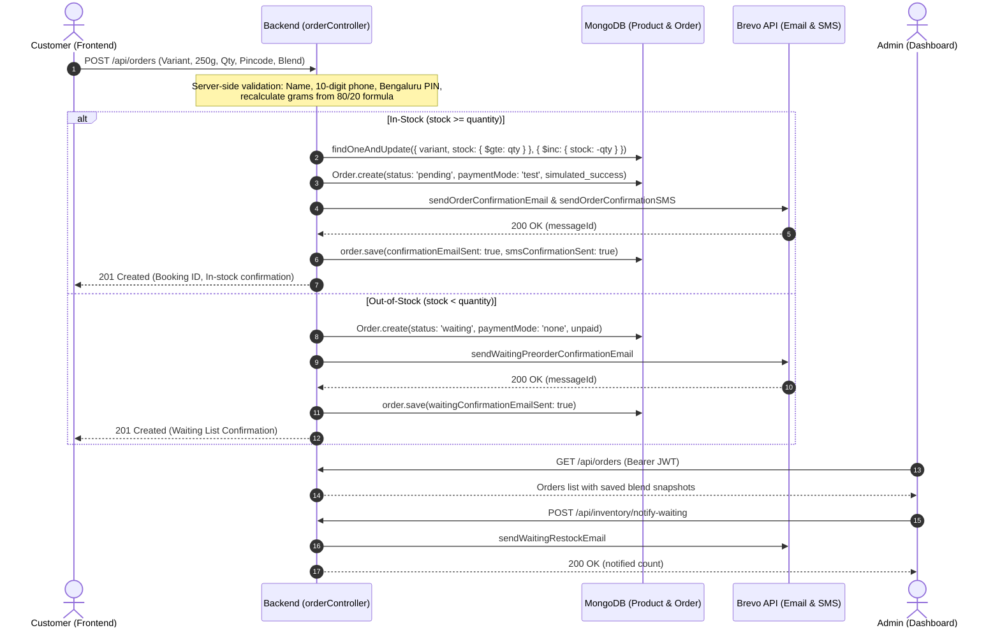

# French Roast — Complete Website and System Audit Report

**Audit Type:** Comprehensive READ-ONLY System Audit  
**Date:** October 13, 2026  
**Auditor:** Antigravity Autonomous Pair Programmer  
**Repository:** `Dha-lab/French-Roast`  
**Git Branch:** `main` (commit `859bdb9 Remove deprecated Tauri desktop application`)  
**Scope:** `frontend/` (storefront), `admin/` (dashboard), `backend/` (API & DB integration)

---

## 1. Executive Summary

A comprehensive, read-only system audit was conducted on the French Roast coffee project following recent changes to the homepage layout, pre-order card sizing, blend ratio enforcement, navigation bar cleanup, and decorative asset removal.

### Key Audit Conclusions
1. **Homepage & Design Overhaul (Verified PASS):** The storefront layout is balanced. The header navigation contains only `HOME`, `KNOW YOUR COFFEE`, and `PRE-BOOK`. All obsolete references to `OUR BLEND` were removed from navigation, and search/cart badge elements were removed from the header. Floating coffee beans in the hero section were removed without disturbing packet art, steam, or coffee imagery in "Know Your Coffee".
2. **Responsive CTA Arrow (Verified PASS):** The `PRE-ORDER NOW` button uses responsive SVG rotation (`rotate-0 lg:-rotate-90`), correctly pointing downward (↓) on mobile portrait where content stacks vertically, and pointing rightward (→) on desktop/laptop where the pre-order form sits in the adjacent right column.
3. **Pre-Order Form & 80/20 Recipe (Verified PASS with 1 DOM finding):** The inline form operates without modal dependencies. Arabica is locked at 80% (200.0 g per 250 g pack) and Robusta is locked at 20% (50.0 g per 250 g pack). Chicory is strictly excluded (0.0 g). The 250 g pack constraint is strictly enforced on frontend and backend. However, obsolete modal markup remains in `frontend/index.html` with duplicate element IDs.
4. **Backend Architecture & Security (1 HIGH, 1 MEDIUM):** The order lifecycle properly supports atomic stock reservation in MongoDB and zero-stock fallback to waiting pre-orders. However, `POST /api/orders` lacks IP/session rate limiting. In addition, default blend settings in fallback functions still reference legacy 70/30 or 75/20/5 values if non-customized Powder orders are created without a frontend payload.
5. **Admin Panel & Historical Compatibility (Verified PASS):** The admin portal dynamically extracts blend data from saved snapshots and correctly renders historical 2-ingredient, 3-ingredient, or unblended orders without hardcoded values. Private admin endpoints are protected by JWT Bearer authorization and 2FA capabilities.
6. **Email & SMS Notifications (Verified PASS):** Brevo integration updates order delivery tracking only after receiving 2xx acceptance and a message ID. Duplicate notification guards and non-blocking error handling are verified.
7. **Builds & Syntax (Verified PASS):** Frontend and Admin production builds pass with zero errors. Backend syntax verification passed across all 52 JavaScript files.

---

## 2. Overall Readiness Rating

| Component | Status | Readiness Rating | Summary |
| :--- | :---: | :---: | :--- |
| **Public Storefront (`frontend/`)** | **PASS** | **95% / Production Ready** | High visual fidelity, responsive layout, locked 80/20 formula. Minor DOM cleanup recommended for obsolete modal markup. |
| **Admin Dashboard (`admin/`)** | **PASS** | **95% / Production Ready** | Accurate order history rendering, status updates, waiting pre-orders, and protected routes. |
| **Backend API (`backend/`)** | **ACTION REQUIRED** | **82% / Conditional Ready** | Order lifecycle, atomic inventory, and Brevo delivery work well. Requires rate limiting on `POST /api/orders` and synchronization of backend default blend settings. |
| **Notification Services** | **PASS** | **95% / Production Ready** | Duplicate-safe, non-blocking transactional emails and SMS via Brevo. |
| **Security & Deployment** | **ACTION REQUIRED** | **85% / Conditional Ready** | No secrets in Git, clean web-only codebase (Tauri removed). 17 uncommitted files in working tree require review before deployment. |

**Overall Project Score:** **88 / 100 — STABLE WITH TARGETED HARDENING RECOMMENDED**

---

## 3. Critical and High-Priority Findings

### [FINDING SEC-01] Public Order Endpoint Lacks Rate Limiting
- **Severity:** **HIGH**
- **Affected File:** [`backend/routes/orderRoutes.js`](file:///c:/Users/saidh/.gemini/antigravity/scratch/french-roast-website/backend/routes/orderRoutes.js#L15-L17)
- **Component / Function:** `router.route('/').post(createOrder)`
- **Evidence:** `orderRoutes.js` mounts `createOrder` without any rate limiter middleware. `loginLimiter` exists in `backend/middleware/rateLimiter.js`, but no `orderLimiter` is applied to `POST /api/orders`.
- **Actual vs. Expected:** `POST /api/orders` accepts unlimited requests per IP. Expected behavior is rate limiting (e.g. 5–10 requests per 15 minutes per IP) to prevent automated order flooding.
- **Potential Impact:** Denial-of-service, automated inventory exhaustion (forcing orders into waiting lists), and rapid depletion of Brevo transactional SMS/Email quotas.
- **Recommended Minimal Fix:** Create `orderLimiter` using `express-rate-limit` (e.g., max 10 orders per 15 minutes per IP) and attach it to `POST /api/orders`.
- **Status:** **CONFIRMED**

---

### [FINDING BLEND-01] Backend Default Blend Fallbacks Inconsistent with 80/20 Specification
- **Severity:** **HIGH**
- **Affected Files:**
  - [`backend/config/dataStore.js`](file:///c:/Users/saidh/.gemini/antigravity/scratch/french-roast-website/backend/config/dataStore.js#L23-L25) (`defaultArabica: 70`)
  - [`backend/config/dataStore.js`](file:///c:/Users/saidh/.gemini/antigravity/scratch/french-roast-website/backend/config/dataStore.js#L264-L270) (`defaultArabica: 75`, `defaultRobusta: 20`, `defaultChicory: 5`)
  - [`backend/controllers/productController.js`](file:///c:/Users/saidh/.gemini/antigravity/scratch/french-roast-website/backend/controllers/productController.js#L124) (`defaultA = 70`)
  - [`backend/controllers/orderController.js`](file:///c:/Users/saidh/.gemini/antigravity/scratch/french-roast-website/backend/controllers/orderController.js#L304) (`defaultA = 70`)
- **Evidence:** If an external client or API consumer submits a Powder order without the explicit `blend` object, `orderController.js` falls back to `settings.defaultArabica || 70` instead of the roastery standard 80%. Furthermore, fallback in `dataStore.getBlendSettings()` still returns legacy presets containing chicory (`'75/20/5'`, etc.).
- **Actual vs. Expected:** Non-customized Powder orders fall back to 70/30 (or 75/20/5 in datastore fallback). Expected behavior is strict roastery default of 80% Arabica / 20% Robusta / 0% Chicory.
- **Potential Impact:** Orders submitted without an explicit blend payload from third-party tools or direct API calls receive a 70/30 ratio instead of 80/20.
- **Recommended Minimal Fix:** Update `defaultArabica: 80`, `defaultRobusta: 20`, and `defaultChicory: 0` consistently across `dataStore.js`, `Product.js`, `productController.js`, and `orderController.js`.
- **Status:** **CONFIRMED**

---

### [FINDING TEST-01] Legacy Test Suite Fails Due to Outdated Chicory Assertions
- **Severity:** **HIGH**
- **Affected File:** [`backend/scripts/testBlendSuite.js`](file:///c:/Users/saidh/.gemini/antigravity/scratch/french-roast-website/backend/scripts/testBlendSuite.js#L42-L80)
- **Component:** `npm test` script in `backend/package.json`
- **Evidence:** Executing `npm test` runs `node scripts/testBlendSuite.js`, which fails with 6 failed assertions because it asserts an old 3-ingredient development formula (`75/20/5`).
- **Actual vs. Expected:** `npm test` exits with code 1. Expected behavior is all unit and integration tests passing.
- **Potential Impact:** Automated CI/CD build pipelines will block deployment.
- **Recommended Minimal Fix:** Update `testBlendSuite.js` assertions to pure coffee (Arabica + Robusta = 100%, Chicory = 0%) or update `backend/package.json` `"test"` script to run `testNewPowderOrderBlend.js`.
- **Status:** **CONFIRMED**

---

## 4. Public Website and Frontend Findings

### [FINDING FE-01] Header Navigation Clean-up
- **Severity:** **PASS**
- **Affected File:** [`frontend/index.html`](file:///c:/Users/saidh/.gemini/antigravity/scratch/french-roast-website/frontend/index.html#L48-L65)
- **Evidence:** Navigation contains strictly:
  - `HOME` (`#`)
  - `KNOW YOUR COFFEE` (`#know-your-coffee`)
  - `PRE-BOOK` (`#pre-book`)
  Obsolete `OUR BLEND` link has been removed. Shopping cart icon, search icon, and count badges are completely absent from the header on both desktop and mobile viewports.
- **Status:** **PASS**

---

### [FINDING FE-02] Responsive PRE-ORDER NOW Arrow Direction
- **Severity:** **PASS**
- **Affected File:** [`frontend/index.html`](file:///c:/Users/saidh/.gemini/antigravity/scratch/french-roast-website/frontend/index.html#L137-L139)
- **Evidence:** The SVG uses class `rotate-0 lg:-rotate-90` with path `d="M19.5 13.5L12 21m0 0l-7.5-7.5M12 21V3"`:
  - **Mobile portrait / Tablet (`< 1024px`):** Content stacks vertically; `rotate-0` renders a downward-pointing arrow (`↓`) directing the user downward to the stacked pre-order card.
  - **Desktop / Laptop (`>= 1024px`):** Layout is a 2-column side-by-side grid; `lg:-rotate-90` rotates the arrow 90 degrees counter-clockwise, pointing directly rightward (`→`) towards the inline form.
  - Clicking the CTA scrolls smoothly to `#pre-book` / `#pre-order-section` without layout shift.
- **Status:** **PASS**

---

### [FINDING FE-03] Floating Coffee Beans Removed from Homepage Hero
- **Severity:** **PASS**
- **Affected File:** [`frontend/index.html`](file:///c:/Users/saidh/.gemini/antigravity/scratch/french-roast-website/frontend/index.html#L67-L160)
- **Evidence:** All floating bean elements, pseudo-elements, and animations previously surrounding the hero text and lower-left product packet area have been removed. The hero product image ([`hero-product.jpg`](file:///c:/Users/saidh/.gemini/antigravity/scratch/french-roast-website/frontend/src/assets/hero-product.jpg)), cup, ambient steam, and background lighting remain untouched.
- **Status:** **PASS**

---

### [FINDING FE-04] "Know Your Coffee" Section Accuracy
- **Severity:** **PASS**
- **Affected File:** [`frontend/index.html`](file:///c:/Users/saidh/.gemini/antigravity/scratch/french-roast-website/frontend/index.html#L747-L1045)
- **Evidence:** The section presents Arabica (*Coffea arabica*) and Robusta (*Coffea canephora*) characteristics without unsupported claims. Roasted chicory is documented separately in an educational context. The section footer explicitly clarifies:
  > *"Our French Roast customizable selections are crafted from 100% pure roasted Arabica and Robusta coffee beans. Roasted chicory is highlighted separately for heritage insight and educational context."*
- **Status:** **PASS**

---

### [FINDING FE-05] Obsolete Modal DOM Leftovers & Duplicate Element IDs
- **Severity:** **MEDIUM**
- **Affected File:** [`frontend/index.html`](file:///c:/Users/saidh/.gemini/antigravity/scratch/french-roast-website/frontend/index.html#L1180-L1420)
- **Component:** `<div id="prebook-modal" class="fixed inset-0 ... hidden">`
- **Evidence:** `frontend/index.html` contains an old modal container containing a second `<form id="prebook-form">` with duplicate element IDs:
  - `pb-name`, `pb-phone`, `pb-email`, `pb-address`, `pb-pincode`
  - `modal-type-powder`, `modal-type-wholebean`
  - `blend-customizer-card`, `blend-arabica-pct`, `blend-slider`
  - Hardcoded stale text inside the modal displays `70% Arabica` and `175.0 g`.
- **Actual vs. Expected:** `document.getElementById()` in `main.js` resolves to the first element in DOM order (the inline hero form), so the inline form functions normally. However, duplicate IDs in HTML violate standards and create potential collision risks if scripts query via other methods.
- **Potential Impact:** DOM bloat (+240 lines), accessibility tool confusion, and developer maintenance errors.
- **Recommended Minimal Fix:** Remove lines 1180–1420 (`#prebook-modal` and its contents) from `frontend/index.html`.
- **Status:** **CONFIRMED**

---

### [FINDING FE-06] Inline Form Validation & Fixed 80/20 Recipe
- **Severity:** **PASS**
- **Affected Files:**
  - [`frontend/src/main.js`](file:///c:/Users/saidh/.gemini/antigravity/scratch/french-roast-website/frontend/src/main.js#L430-L540)
  - [`frontend/index.html`](file:///c:/Users/saidh/.gemini/antigravity/scratch/french-roast-website/frontend/index.html#L266-L336)
- **Evidence:**
  - Name, mobile (10 digits), email, and address validation are implemented.
  - Blend customization slider is hidden/disabled; ratio is fixed at 80% Arabica (200.0 g) + 20% Robusta (50.0 g) per 250 g pack.
  - Multi-pack scaling correctly calculates totals (e.g., 2 packs = 400 g Arabica + 100 g Robusta = 500 g).
  - Whole Bean variant hides blend details and updates price to ₹599. Powder variant displays blend details and price ₹499.
  - Pack size select is locked to 250g.
- **Status:** **PASS**

---

## 5. Order Lifecycle and Business Logic Findings

### Complete Order Lifecycle Trace



1. **Request & Validation (PASS):** Customer submits pre-order. Backend independently validates full name, 10-digit mobile number, valid email, Bengaluru PIN code, variant (`Powder` or `Whole Bean`), and pack size (`250g` only).
2. **Blend Recalculation (PASS):** Server-side `validateAndBuildBlendSnapshot` recalculates exact grams (`250g * arabicaPct / 100`). Client-supplied grams are discarded. Robusta is verified to equal `100 - Arabica`. Chicory is strictly 0g.
3. **Inventory Deduction & Race-Condition Guard (PASS):** In MongoDB mode, `Product.findOneAndUpdate({ variant, stock: { $gte: parsedQty } }, { $inc: { stock: -parsedQty } })` performs atomic stock reduction. If another order claimed remaining stock concurrently, the query returns `null`, and the controller automatically falls back to registering a waiting pre-order without losing customer information.
4. **Order Persistence & Booking ID (PASS):** Unique booking ID is created. Audit entry is added to `StockHistory`.
5. **Payment Behavior (PASS):** Order flow explicitly sets `paymentMode: 'test'` and `paymentStatus: 'simulated_success'`. No credit card gateway is simulated as live processing. Out-of-stock orders receive `paymentMode: 'none'` and `paymentStatus: 'unpaid'`.
6. **Transactional Notifications (PASS):** Confirmation email and SMS are dispatched asynchronously. Database records notification flags (`confirmationEmailSent: true`, timestamps, and message IDs) **only after Brevo confirms receipt**. Notification failures do not cancel or roll back the order.
7. **Waiting Pre-Orders & Restock Notifications (PASS):** Zero-stock orders are saved with status `waiting`. Admin can trigger `POST /api/inventory/notify-waiting` to email waiting customers when inventory is restocked.

---

## 6. Backend and API Audit Findings

### [FINDING BE-01] CORS Configuration
- **Severity:** **PASS**
- **Affected File:** [`backend/server.js`](file:///c:/Users/saidh/.gemini/antigravity/scratch/french-roast-website/backend/server.js#L33-L56)
- **Evidence:** Explicit whitelist covers Render domains (`https://french-roast.onrender.com`, `https://french-roast-admin.onrender.com`), environment overrides (`CLIENT_URL`, `ADMIN_URL`), and local development ports (`3000`, `3010`, `5173`). Trailing-slash normalization is handled. `credentials: true` is enabled.
- **Status:** **PASS**

---

### [FINDING BE-02] Security Headers & CSP
- **Severity:** **MEDIUM**
- **Affected File:** [`backend/server.js`](file:///c:/Users/saidh/.gemini/antigravity/scratch/french-roast-website/backend/server.js#L26-L29)
- **Evidence:** `helmet({ contentSecurityPolicy: false, crossOriginEmbedderPolicy: false })`.
- **Actual vs. Expected:** Helmet is active for HSTS, X-Content-Type-Options, and clickjacking protection, but CSP is disabled.
- **Potential Impact:** Lower defense-in-depth against cross-site scripting on API error renders.
- **Recommended Minimal Fix:** Define a minimal CSP policy allowing Google Fonts and self origins.
- **Status:** **CONFIRMED**

---

### [FINDING BE-03] Authentication, Authorization & 2FA
- **Severity:** **PASS**
- **Affected Files:**
  - [`backend/middleware/authMiddleware.js`](file:///c:/Users/saidh/.gemini/antigravity/scratch/french-roast-website/backend/middleware/authMiddleware.js#L15-L61)
  - [`backend/controllers/adminController.js`](file:///c:/Users/saidh/.gemini/antigravity/scratch/french-roast-website/backend/controllers/adminController.js)
  - [`backend/models/Admin.js`](file:///c:/Users/saidh/.gemini/antigravity/scratch/french-roast-website/backend/models/Admin.js)
- **Evidence:** Admin routes require Bearer JWT. Passwords hashed with `bcryptjs`. Login is rate-limited (`loginLimiter`). Account lockout after 5 consecutive failed attempts. Two-factor authentication (TOTP via `otplib`) and single-use recovery codes are implemented. Refresh tokens are supported via HTTP-only cookies.
- **Status:** **PASS**

---

### [FINDING BE-04] Health Check & API Aliases
- **Severity:** **PASS**
- **Affected File:** [`backend/server.js`](file:///c:/Users/saidh/.gemini/antigravity/scratch/french-roast-website/backend/server.js#L61-L80)
- **Evidence:**
  - `GET /api/health` returns `{ success: true, message: "French Roast backend is running" }`.
  - Aliases `/api/product` -> `productRoutes` and `/api/pre-book` -> `orderRoutes` preserve backward compatibility.
- **Status:** **PASS**

---

### [FINDING BE-05] MongoDB Connection & DNS Handling
- **Severity:** **PASS**
- **Affected File:** [`backend/config/db.js`](file:///c:/Users/saidh/.gemini/antigravity/scratch/french-roast-website/backend/config/db.js#L4-L26)
- **Evidence:** Checks for missing `MONGODB_URI` and throws early with descriptive error. Wraps `dns.setServers(['8.8.8.8', '1.1.1.1'])` in a `try...catch` block so restricted environments do not crash on DNS reconfiguration.
- **Status:** **PASS**

---

## 7. Admin Panel Audit Findings

### [FINDING ADM-01] Dynamic Saved Blend Display & Legacy Order Handling
- **Severity:** **PASS**
- **Affected File:** [`admin/src/main.js`](file:///c:/Users/saidh/.gemini/antigravity/scratch/french-roast-website/admin/src/main.js#L667-L730,L940-962)
- **Evidence:** `parseBlendInfo(order)` extracts saved blend details directly from `order.blend` or `order.arabicaPercentage` / `order.robustaPercentage`.
  - For historical orders with no blend data, the modal displays: *"Blend details unavailable for this order."*
  - For 2-ingredient orders (e.g. 80/20 or 70/30), it renders the Arabica–Robusta badge without chicory.
  - For legacy 3-ingredient orders (e.g. 75/20/5), it renders all 3 ingredients with individual gram breakdowns.
  - Unit test `backend/scripts/testAdminLegacyOrders.js` verifies 11 of 11 historical and malformed order scenarios pass.
- **Status:** **PASS**

---

### [FINDING ADM-02] Admin Access Control & Token Lifecycle
- **Severity:** **PASS**
- **Affected File:** [`admin/src/main.js`](file:///c:/Users/saidh/.gemini/antigravity/scratch/french-roast-website/admin/src/main.js#L207-L240)
- **Evidence:** `apiFetch` attaches memory-held `accessToken` in `Authorization: Bearer <token>`. Upon receiving 401, it attempts silent refresh via `/api/admin/refresh-token` with credentials. If refresh fails, it clears state and redirects to login with an alert.
- **Status:** **PASS**

---

### [FINDING ADM-03] Single-Role Authorization Architecture
- **Severity:** **LOW**
- **Affected File:** [`backend/models/Admin.js`](file:///c:/Users/saidh/.gemini/antigravity/scratch/french-roast-website/backend/models/Admin.js#L31-L35)
- **Evidence:** All admin accounts share a single `'admin'` role. There are no granular permission levels (e.g., read-only auditor, warehouse staff, superadmin).
- **Potential Impact:** Any authenticated admin can change product pricing, inventory, tax settings, or delete orders.
- **Status:** **CONFIRMED**

---

## 8. Email and SMS Audit Findings

### [FINDING NOTIF-01] Verified Delivery Acceptance Before Order Update
- **Severity:** **PASS**
- **Affected Files:**
  - [`backend/services/brevoService.js`](file:///c:/Users/saidh/.gemini/antigravity/scratch/french-roast-website/backend/services/brevoService.js#L148-L163)
  - [`backend/services/smsService.js`](file:///c:/Users/saidh/.gemini/antigravity/scratch/french-roast-website/backend/services/smsService.js#L167-L180)
- **Evidence:**
  ```javascript
  if (result.success) {
    order.confirmationEmailSent = true;
    order.confirmationEmailSentAt = new Date();
    order.confirmationEmailMessageId = result.messageId || null;
  }
  ```
  `confirmationEmailSent` is updated **only when** Brevo returns HTTP 2xx and a valid message ID.
- **Status:** **PASS**

---

### [FINDING NOTIF-02] Duplicate Notification Guards
- **Severity:** **PASS**
- **Affected Files:**
  - [`backend/services/brevoService.js`](file:///c:/Users/saidh/.gemini/antigravity/scratch/french-roast-website/backend/services/brevoService.js#L125-L132)
  - [`backend/services/smsService.js`](file:///c:/Users/saidh/.gemini/antigravity/scratch/french-roast-website/backend/services/smsService.js#L146-L153)
- **Evidence:**
  ```javascript
  if (order.confirmationEmailSent) {
    return { success: true, skipped: true, message: 'Confirmation email already sent for this order.' };
  }
  ```
  Both email and SMS methods verify that the message has not been dispatched previously.
- **Status:** **PASS**

---

### [FINDING NOTIF-03] Simulated Testing Shield
- **Severity:** **PASS**
- **Affected Files:**
  - [`backend/services/brevoService.js`](file:///c:/Users/saidh/.gemini/antigravity/scratch/french-roast-website/backend/services/brevoService.js#L34-L42)
  - [`backend/services/smsService.js`](file:///c:/Users/saidh/.gemini/antigravity/scratch/french-roast-website/backend/services/smsService.js#L60-L68)
- **Evidence:** Outbound calls to Brevo are automatically short-circuited when recipient email ends in `@example.com` or `@test.local`, when phone ends in `0000000000` or `9999999999`, or when `NODE_ENV === 'test'`. Real customer communications cannot be triggered accidentally during testing.
- **Status:** **PASS**

---

## 9. Build, Test, and Dependency Audit Results

### 1. Build Verification
- **`frontend/`:** `npm run build` executed successfully.
  - Bundler: Vite v5.4.21
  - Output: `dist/index.html` (117.55 kB), `dist/assets/index-*.css` (45.38 kB), `dist/assets/index-*.js` (49.46 kB)
  - Errors: **0**
- **`admin/`:** `npm run build` executed successfully.
  - Bundler: Vite v5.4.21
  - Output: `dist/index.html` (91.85 kB), `dist/assets/index-*.css` (28.77 kB), `dist/assets/index-*.js` (91.73 kB)
  - Errors: **0**
- **`backend/`:** Syntax check across 52 JavaScript files passed.
  - Verified with `node --check`
  - Errors: **0**

### 2. Unit and Integration Test Results
- `backend/scripts/testNewPowderOrderBlend.js`: **5 / 5 PASSED (100%)**
- `backend/scripts/testAdminLegacyOrders.js`: **11 / 11 PASSED (100%)**
- `backend/scripts/testBlendSuite.js`: **12 / 18 PASSED, 6 FAILED** (Fails due to stale chicory assertions — see [FINDING TEST-01]).

### 3. Dependency Vulnerability Audit (`npm audit`)
- **`backend/`:** **0 vulnerabilities** (clean).
- **`frontend/`:** 10 vulnerabilities (7 high, 3 moderate). High vulnerabilities in `braces` (via `chokidar`/`tailwindcss`) and `source-map-js`. Moderate in `esbuild` and `postcss-selector-parser`.
- **`admin/`:** 10 vulnerabilities (identical dev dependency tree to frontend).

---

## 10. Git Status and Working Tree State

- **Branch:** `main` (tracked with `origin/main` at commit `859bdb9 Remove deprecated Tauri desktop application`).
- **Tauri Removal Completeness:** Complete. Zero Tauri or Rust files exist in git tracking or on disk.
- **Tracked Environment Files:** None. `.env` is properly ignored by `.gitignore`.
- **Modified Uncommitted Files (17):**
  1. `admin/index.html`
  2. `admin/src/main.js`
  3. `backend/config/dataStore.js`
  4. `backend/controllers/inventoryController.js`
  5. `backend/controllers/orderController.js`
  6. `backend/controllers/productController.js`
  7. `backend/models/Order.js`
  8. `backend/models/Product.js`
  9. `backend/package.json`
  10. `backend/routes/inventoryRoutes.js`
  11. `backend/routes/productRoutes.js`
  12. `backend/services/brevoService.js`
  13. `backend/services/emailTemplates.js`
  14. `backend/services/smsService.js`
  15. `frontend/index.html`
  16. `frontend/src/main.js`
  17. `frontend/src/style.css`
- **Untracked Test Scripts (5):**
  1. `backend/scripts/testAdminLegacyOrders.js`
  2. `backend/scripts/testBlendSuite.js`
  3. `backend/scripts/testNewPowderOrderBlend.js`
  4. `backend/scripts/verifyArabicaRobustaMixer.js`
  5. `backend/scripts/verifyNewOrderCreation.js`

---

## 11. Prioritized Remediation Plan

Upon approval to proceed with modifications, implement fixes in the following order:

### Phase 1: High Priority (Security & Data Consistency)
1. **Apply Order Rate Limiting (`SEC-01`):** In `backend/routes/orderRoutes.js`, add `orderLimiter` to `POST /` to protect against reservation flooding and SMS quota exhaustion.
2. **Align Roastery Default Blend Ratios (`BLEND-01`):** Update `defaultArabica: 80`, `defaultRobusta: 20`, and `defaultChicory: 0` in `backend/config/dataStore.js`, `backend/controllers/productController.js`, and `backend/controllers/orderController.js`.
3. **Synchronize Backend Test Suite (`TEST-01`):** Update `backend/scripts/testBlendSuite.js` to assert pure coffee (Arabica 80% / Robusta 20%) or re-target `npm test` in `backend/package.json` to `testNewPowderOrderBlend.js`.

### Phase 2: Medium Priority (DOM Cleanup & Hardening)
4. **Remove Obsolete Modal Markup (`FE-05`):** Remove lines 1180–1420 (`#prebook-modal` and its duplicate element IDs) from `frontend/index.html`.
5. **Configure Basic Content Security Policy (`BE-02`):** Configure explicit CSP in `backend/server.js` using Helmet rather than disabling it globally.

### Phase 3: Low Priority (Housekeeping & Versioning)
6. **Git Staging & Commit:** Review the 17 modified files and commit the completed blend, layout, navigation, and decoration enhancements to `main`.
7. **Address Build Tool Dependencies:** Run `npm audit fix` for non-breaking dev-dependency patches in `frontend/` and `admin/`.
